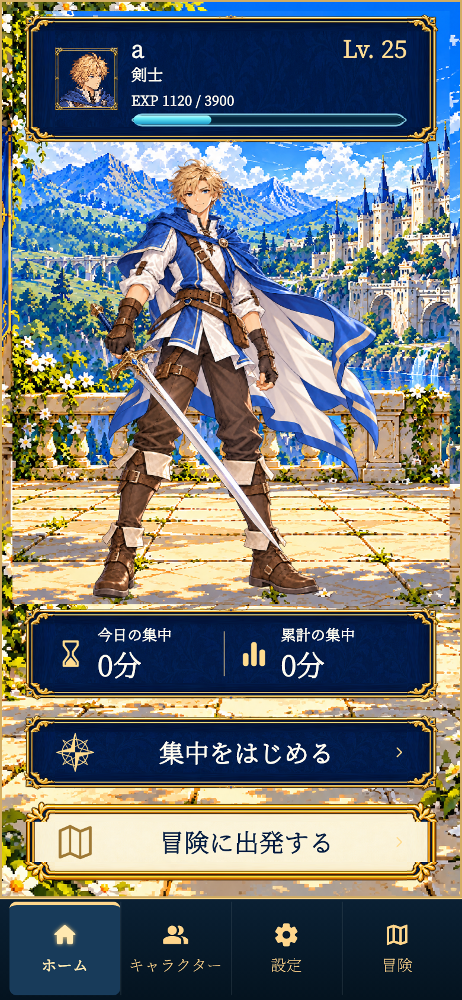
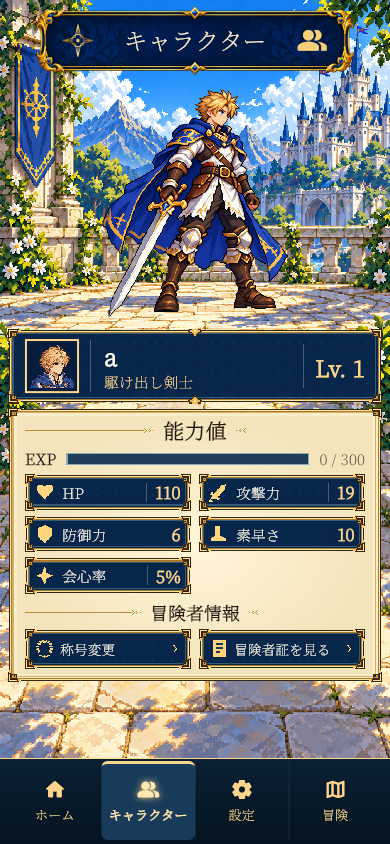
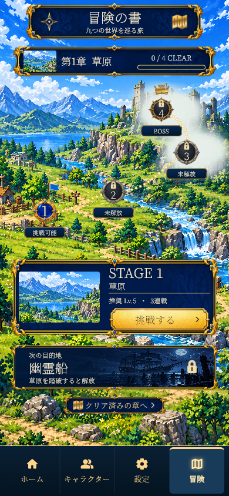

# FocusQuest

**集中した時間が、冒険と成長に変わる。**

FocusQuestは、集中タイマーとドット絵RPGを組み合わせたFlutterアプリです。勉強や作業で経験値をため、育てたキャラクターと九つの世界を冒険します。

Android向けに開発中。Windowsでも画面とゲームの動作を確認できます。

[開発ガイド](docs/DEVELOPMENT.md) · [更新内容](docs/UPDATE_2026-10-30.md) · [検証状況](docs/VALIDATION_2026-10-30.md)

## 画面イメージ

<table>
  <tr><th>ホーム</th><th>キャラクター</th><th>冒険</th></tr>
  <tr>
    <td></td>
    <td></td>
    <td></td>
  </tr>
</table>

2026年10月30日の開発版の画面です。端末サイズや開発状況により表示は異なります。

## できること

- **集中して育成** — 15・30・45・60分、または1〜180分のタイマー。集中成功で経験値を獲得し、日別の記録と継続日数を残せます。
- **自分のキャラクターで冒険** — 初回の10問の診断で16職から職業を決定。男女の見た目、レベル成長、称号、冒険者証に対応します。
- **九つの世界・36ステージ** — 通常攻撃とスキルで敵やボスに挑み、クリアしたエリアを集中コースとして解放します。
- **最大4人でパーティー集中** — 6文字のコードで参加し、同じ時刻に集中を開始。オンライン機能には対応するパーティーサーバーが必要です。
- **原画を切り替えるドット絵アニメーション** — 完成したPNG原画をそのまま再生します。

通常のゲーム記録は端末内に保存します。アカウント登録やクラウド同期には対応していません。アプリの削除やデータ消去で記録も削除されます。

## 開発環境で起動する

検証環境は **Flutter 3.24.3 / Dart 3.5.3** です。AndroidのビルドにはJava 17とAndroid SDK、Windowsの実行にはFlutterのWindows開発環境を用意してください。

```sh
git clone https://github.com/eido0916/focusquest.git
cd focusquest/mobile
flutter pub get
flutter run
```

複数の端末がある場合は `flutter devices` で確認し、`flutter run -d <device-id>` で指定します。日本語を含むWindowsパスでビルドに失敗する場合は、英数字だけのパスにcloneしてください。

Android向けの開発用APK:

```sh
flutter build apk --debug --target-platform android-arm64 --dart-define=FOCUSQUEST_DEVELOPER_TOOLS=false
```

生成先: `mobile/build/app/outputs/flutter-apk/app-debug.apk`。ストア配布用の署名は未設定です。設定画面の仮設開発者ツールは上記の指定で非表示になります。

詳しい環境構築・別の起動方法・Windows用補助スクリプトは[開発ガイド](docs/DEVELOPMENT.md)、パーティーサーバーの起動と接続設定は[パーティー機能](docs/PARTY.md)と[サーバー公開手順](server/DEPLOY.md)を参照してください。

## 開発状況と確認方法

2026年10月30日の既存の[一括検証記録](docs/VALIDATION_2026-10-30.md)では、静的解析は指摘なし、テストは529件成功・37件失敗・1件スキップです。全体テストは未通過で、Android実機での追加一括検証も未実施です。この数値は当該記録時点の結果です。

```sh
cd mobile
flutter analyze --no-pub
flutter test --no-pub
```

Androidのアプリ警告には「使用状況へのアクセス」と「他のアプリの上に表示」の許可が必要です。監視は端末内で処理します。オンラインパーティーで送信する情報と制約は[パーティー機能](docs/PARTY.md)を参照してください。

## リポジトリ構成

| 場所 | 内容 |
| --- | --- |
| [mobile/](mobile/) | Flutterアプリ本体・Android / Windows設定・テスト |
| [server/](server/) | Dart製パーティーサーバーと公開設定 |
| [docs/](docs/README.md) | 開発・仕様・検証のドキュメント |
| [art/](art/) | UI素材・原画・制作履歴 |
| [scripts/](scripts/) | 素材生成・確認・ビルド補助 |
| [playable-demo/](playable-demo/README.md) | 制作履歴として保持するブラウザ版デモ |

ルートのHTML / CSS / JavaScriptも以前のWebタイマーです。現在のアプリ本体は `mobile/` です。

## 参加・素材の取り扱い

不具合報告や変更提案は[コントリビューションガイド](CONTRIBUTING.md)を参照してください。コードや素材の利用条件は[ライセンスとクレジット](docs/LICENSING.md)にまとめています。
