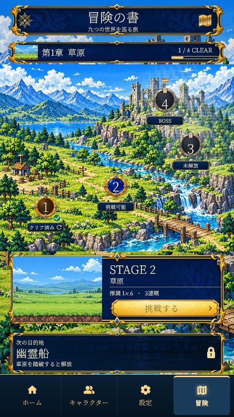
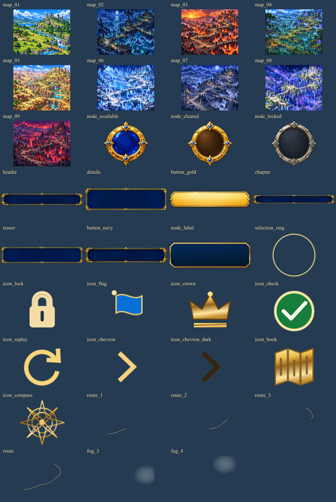

# 冒険の書・地図型ステージ選択 v001

2026-10-29。承認された `adventure_map_concept_v001/stage-map-concept.png` をもとに、アプリのステージ選択を実装。見本は `reference.png`。

## 進行と操作

- 現在の章の4ステージをドット絵の地図と光の道で表示。挑戦可能は青と旗、クリア済みは銅とチェック、未解放は銀・鍵・霧、章ボスは王冠で区別する。
- 未クリアの次の1ステージだけを新しい挑戦先にする。未解放を選ぶと詳細欄に直前のStageのクリア条件を表示し、挑戦を無効にする。開始処理でも解放状態を確認する。
- ノードを選ぶと下のパネルを更新。挑戦できるノード／挑戦ボタンから既存の敵の詳細と確認画面を開き、そこから戦闘へ進む。未遭遇の敵は引き続き伏せる。
- クリア済みのStageは何度でも再挑戦できる。「クリア済みの章へ」または右上の本から、過去の章と進行中の章を選べる。
- 次章は予告と解放条件のみ表示。章の4ステージをクリアすると「次の章へ進む」に変わる。それ以降の未踏の章は一覧に出さない。
- 既存のクリア・討伐・遭遇記録を引き継ぐ。過去に順不同でクリアされた記録がある場合も、そのStageの再挑戦は残す。
- 集中中・保存失敗時の冒険開始制限と再保存、戦闘後の帰還を維持。既存のキャラクター・敵の原画アニメーションには変更なし。
- 戦闘開始の検証で見つかったフェーズ表示の縦はみ出しは、文字を1行に制限して修正。

## 素材35点

全点を `materials/` と `mobile/assets/images/adventure_map_v001/` に個別PNGとして保存。寸法・制作方法・SHA256は [manifest.json](manifest.json)、一致検証は [asset-verification.json](asset-verification.json)。

|素材|点数|内容|
|---|---:|---|
|map_01〜map_09|9|草原、幽霊船、火山、毒茸の湿地、砂漠の迷宮、氷晶洞窟、月影の墓地、星界の祭壇、魔王城|
|node_available / node_cleared / node_locked|3|青・金、銅・金、灰・銀の独立したステージ枠|
|header / details / button_gold|3|見出し、詳細、金の挑戦ボタン|
|chapter / teaser / button_navy|3|章情報、次章予告、紺のボタン用の独立した枠素材|
|node_label / selection_ring|2|状態ラベルの枠、選択の輪|
|icon_*|9|鍵、旗、王冠、チェック、再挑戦、矢印2色、本、コンパス|
|route / route_1〜route_3|4|道の全体と3つの接続区間|
|fog_3 / fog_4|2|未解放地点に重ねる独立した霧|

背景9点・ノード3点・装飾3点は組み込みImageGenで1点ずつ制作。生成元は `originals/`、[全15件の生成指示](generation-prompts.json)を保存。背景の表示は最近傍法。透過枠は余白を除いてアプリ用サイズへ正規化し、文字・番号・鍵などは別レイヤーで配置する。小物と道は既存の装飾系統に合わせた個別SVGで、編集元は `vectors/`。

## 実装と再生成

- `mobile/lib/features/playable_stage/presentation/adventure_map_scene.dart`：新しい画面と独立した描画部品。
- `mobile/lib/features/playable_stage/domain/stage_progress.dart`：解放順・再挑戦・章の進捗。
- `playable_stage_selection_page.dart`：既存の戦闘・保存処理と接続。
- `node scripts/package-adventure-map-v001.cjs`：原本・SVGから個別素材と一覧を作成。生成キャッシュがない場合は保存済み `originals/` を参照。
- `node scripts/review-adventure-map-v001.cjs`：素材の一致検証と実画面プレビューの取り込み。

## 検証

地図UI・全36ステージの解放順16件、敵の詳細5件、育成・保存・戦闘への遷移7件、既存ステージ選択とボス撃破6件、計34件合格。320px幅・横画面・文字倍率1.6、全9章・全踏破時を含む。静的解析は指摘なし。全35素材の制作版とアプリ版のSHA256一致を確認。

[9章の実画面一覧](previews/nine-chapters.png)。草原の比較用画像はStage 1をクリアしたテストデータで撮影し、ユーザーの保存データは変更していない。

Windows releaseビルド成功。更新版を起動し、ウィンドウの応答を確認。
