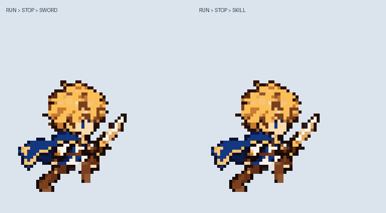
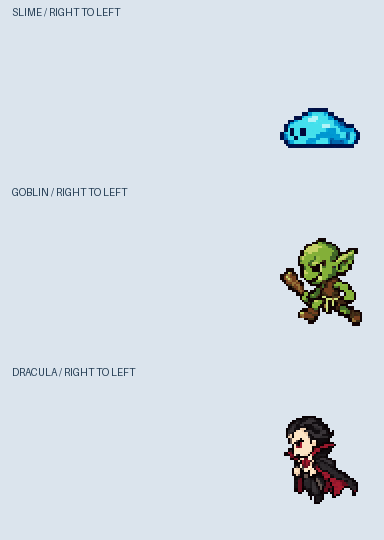
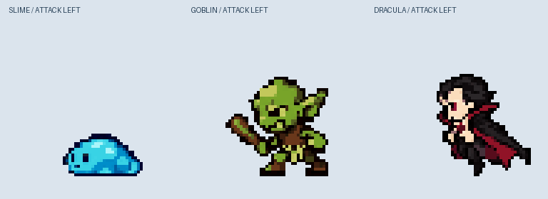

# 主人公・敵モーション素材

128×128のミニキャラ版を中心に、制作したモーション・透過PNG・プレビュー・編集元・時間情報を収録。既存アプリのキャラクター素材と区別して保存しており、アプリへの登録や表示切替はこのコミットには含まない。

## 実装候補：ミニキャラ128×128

| 素材 | フォルダ | 内容 |
|---|---|---|
| 主人公の立ち絵 | [field_pixel_v001](character_01/field_pixel_v001/) | 剣を持つ静止PNG |
| 主人公の走行 | [field_run_v001](character_01/field_run_v001/) | 右向き、6姿勢、0.5秒ループ |
| 主人公の通常攻撃 | [field_attack_down_v001](character_01/field_attack_down_v001/) | 停止して剣を振り下ろす、8コマ、1秒 |
| 主人公のスキル | [field_skill_wave_v001](character_01/field_skill_wave_v001/) | 剣の溜め→振り下ろし→短い衝撃波、12コマ、1.5秒 |
| 主人公の連結確認 | [motion_bundle_v001](character_01/motion_bundle_v001/) | 走行→停止→通常攻撃／スキルの2本 |
| 敵の移動 | [enemies_v001](enemies_v001/) | スライム・ゴブリン・ドラキュラ、各6姿勢、左向き |
| 敵の攻撃 | [enemy_attacks_v001](enemy_attacks_v001/) | スライムの体当たり・棍棒の振り下ろし・魔力弾、各8コマ、1秒 |

各フォルダのREADMEとanimation.jsonが、再生順・保持時間・移動量・寸法の仕様。`frames`は姿勢ごとの画像、`frames_24fps`や`cycle_24fps`は24fps表示の連番で、同じ姿勢を保持するため重複画像を含む。エフェクト層がある素材では、キャラクター層と重ねると完成フレームに一致する。

## その他の主人公素材と制作履歴

[animation_v005](character_01/animation_v005/)がイラスト版／ドット版の右向き走行の最新試作。実装256×256、制作1024×1024、24fps・1秒。骨格、配置行列、透過パーツ、編集元、コマ送りHTMLも含む。

animation_v001〜v004は過去の試作を保持。v001には待機も含む。現在のミニキャラ128版とは体形・寸法が異なるため、そのまま混在させず、上の一覧から使う素材を選ぶ。

`reference`に主人公01の元画像、素材仕様書に前工程の基準を保持。残り15体の原画、作業ログ、ZIPの重複、Pythonキャッシュは収録していない。生成指示と生成画像原稿は各sourceフォルダに保存。

## 検証

`file_manifest.json`に全ファイルのSHA-256とサイズ、PNGの読取り検証、現行モーションの枚数・寸法・RGBAの確認結果を記録。各素材内のverification.jsonには制作時のドット・見切れ・再合成などの検査を記録。

今回の追加は素材の受け渡し。Android実機での表示、衝突判定、敵とのダメージ処理、走行から停止する減速遷移の作画は含まない。Pythonの制作元はPillow＋NumPyを使用。
