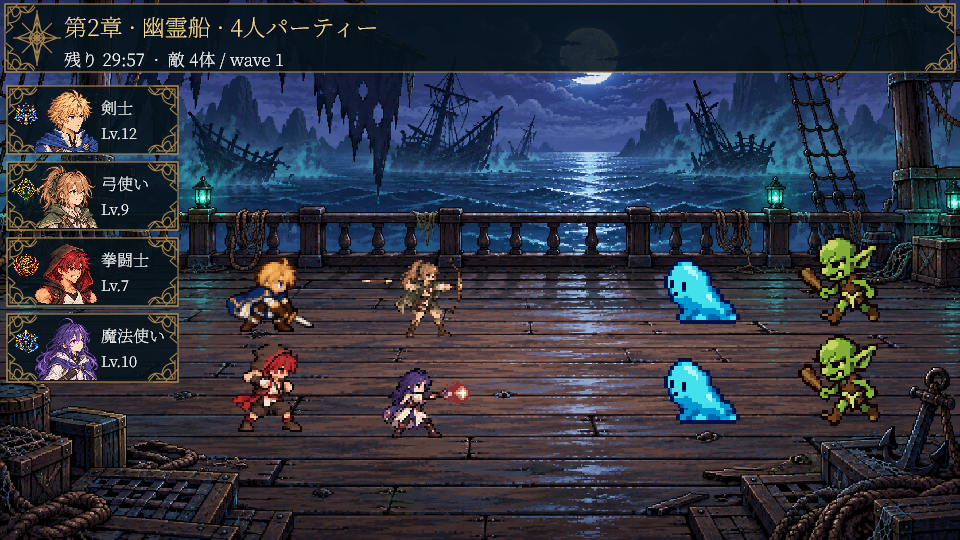
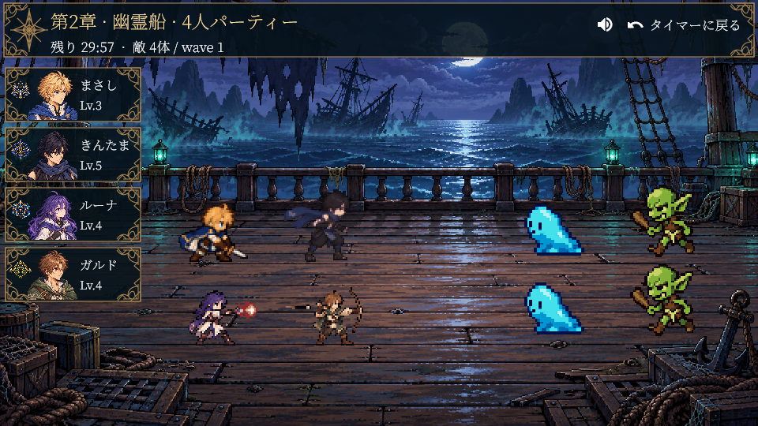

# パーティ集中画面 v001

2026-10-12 の参照画像に合わせた横画面のパーティ集中デザイン。

- 上部は濃紺の半透明パネル・金の細枠と四隅の唐草・コンパス紋章。章、エリア、実際の人数、残り時間、敵数、ウェーブ番号は動的表示。
- 左は4人まで縦に並ぶ仲間カード。既存の focus_selection_v001/avatars/{male,female}/{role}.png を最近傍で表示。職業紋章、名前、レベルのみ。HP・MPを設けない。接続切れ・離脱時のみ通信状態を補記。
- 仲間は戦場の左側2列、敵は右側。背景は一人用集中と共通で、第一章は草原、第二章は幽霊船。
- 既存の原画PNG切替、24fpsの保持時間、スキル効果、音声、集中時計・同期・章進行を継続。画像の変形や補間を追加しない。
- materials に編集可能なSVGとPNGを個別保存。アプリ版は mobile/assets/images/party_focus_v001。生成スクリプトは scripts/package-party-focus.cjs。
- reference.png はユーザーの参照画像を保存した制作資料。アプリ背景として合成していない。

プレビューは実際のFlutter描画を使用する。

[幽霊船・2人](previews/ghost-ship-2.png) / [幽霊船・スキル](previews/ghost-ship-4-skill.png) / [草原・4人](previews/grassland-4.png)

検証: 画面描画10件・オンライン同期5件が合格。静的解析は問題なし。プレビューは戦闘Canvas部分で、実画面では右上にサウンド設定と「タイマーに戻る」を重ねて表示する。

右上の操作ボタンを含む完成画面:

Android ARM64デバッグ版: [新版APK](../../output/android/FocusQuest-party-focus-v001-debug.apk)。APK内53素材のSHA256が元素材と一致。画面描画10件・オンライン5件・完成画面操作3件、計18件が合格。完成画面操作は960×540、844×390、390×844でサウンド設定とタイマーへの復帰を確認。実機での起動確認は未実施。

実機確認追記: TB373FUへ保存データを消さず更新インストールし、起動を確認。端末のAPK SHA256は納品版と一致。共同戦闘そのものは実機未確認。詳細は device-verification.json。
