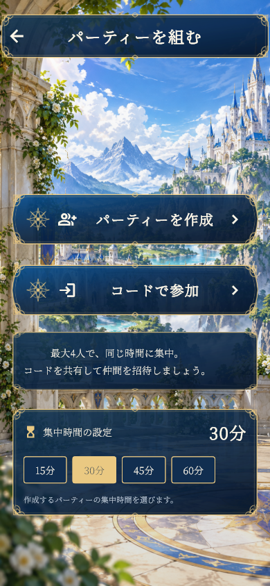

# パーティーロビー v001

2026-10-12。添付の「幻想世界のパーティーロビー UI」「ファンタジー風景のパーティー画面」を参考に、Flutterのパーティー入口・待機室を更新。

- 城・渓谷・滝・石造テラスの新作背景、半透明の濃紺パネル、金の二重枠、コンパスと王冠。
- 入口は「パーティーを作成」「コードで参加」。コード入力はダイアログ。
- 待機室はコードコピー、4枠の既存立ち絵、職業・レベル・本人・リーダー・準備状態。
- 「オンライン接続の設定」を画面から削除し、「集中時間の設定」に置換。15 / 30 / 45 / 60分。作成前の選択を作成後にサーバーへ送信。ゲストはリーダーの時間を表示し、変更不可。集中開始後は変更不可。
- 接続先は既存の標準WSS URLまたはビルド時のPARTY_SERVER_URL。ネットワーク機能、準備確認、同期開始は維持。
- 小画面や大きい文字ではメンバーを2列へ変更。横画面・小画面はスクロールで全操作にアクセス。

個別素材は `materials/`、アプリ素材は `mobile/assets/images/party_lobby_v001/`。背景以外の6素材は編集可能なSVGとPNGを保存。再生成は `node scripts/package-party-lobby.cjs`。立ち絵は既存の `mobile/assets/images/lobby/portraits/` を使用し、元素材・アニメーションには変更なし。

プレビューはFlutterの実画面キャプチャ。

[2人の待機室](previews/lobby-2.png) / [4人の待機室](previews/lobby-4.png) / [コード入力](previews/join.png)

背景は組み込みimage_genで新規生成。プロンプトは [generation-prompt.txt](generation-prompt.txt)。背景PNGは `materials/castle_valley.png`。

検証：ロビー描画・操作11件、オンライン同期5件、集中画面からの遷移1件が合格。静的解析は問題なし。素材7枚の制作版とアプリ版のSHA256一致を `manifest.json` に記録。最初の通信テストでは既存サーバーの接続終了時に `StreamSink is closed` が一度発生し、単独再実行では5件すべて合格。公開サーバー・実機での今回の操作検証は未実施。

再検証：`scripts/verify-party-lobby.ps1`。英数字パスの検証環境から素材をジャンクションで参照し、素材ライブラリを複製しない。

Android版：`output/android/FocusQuest-party-lobby-v001-debug.apk`（ARM64、開発用、628,233,777 bytes）。2026-10-12に現在のソースでビルド成功。APK内の新作7素材と既存男女立ち絵34素材、計41素材のSHA256が元ファイルと一致。ARM64 Flutterランタイムとv1/v2署名を検証済み。詳細は `android-verification.json`、`artifacts/party_lobby_v001_android_final_build.log`、`artifacts/party_lobby_v001_apk_signature.log`。再検証は `scripts/verify-party-lobby-apk.ps1`。実機での確認は未実施。
