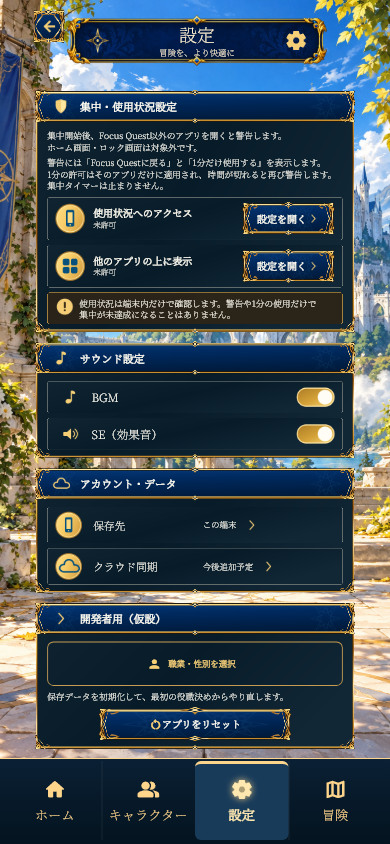

# FocusQuest 最新版の更新内容（2026年10月30日）

現在のPCで動作確認しているFocusQuestを、必要なソース・画像素材・テスト・制作資料とともに整理した更新です。既存の青と金の装飾、キャラクターの外見、原画を切り替えるアニメーション方式を保ち、画面の収まりと操作の一貫性を改善しました。

## 画面と操作の改善

### 端末の縦画面へ収まるレイアウト

ホーム、キャラクター、設定、冒険、集中時間選択、タイマー、パーティー、初回案内の主要画面を調整しました。画面の高さが足りない場合は全体を収める方式とし、主要画面の縦スクロールを撤去しています。文字やアイコンが装飾枠へ重ならないよう、枠の内側の余白も確保しました。

### 下部メニューの固定と統一

表示順を「ホーム／キャラクター／設定／冒険」に揃えました。設定画面だけ別のバーを使う実装と、ページごとに文字・アイコン・バーの高さを変える処理を整理しています。ページを切り替えてもバーやタップ領域の位置は変わらず、選択中の項目だけが共通の青背景・金色の上線・発光表示に切り替わります。

### 背景画像の引き延ばしを解消

冒険マップは元画像の縦横比を保ち、画面から余る端だけを切り取って表示します。背景を操作UIの高さから独立させたため、「集中中」の案内や文字拡大があっても船や岩を縦に変形しません。既存の全9章の画像を使用しています。

### タイマーは縦、戦闘は横

時間選択とタイマーは縦画面を維持します。戦闘表示へ入ると横画面へ切り替わり、タイマーやホームへ戻ると縦画面へ復帰します。横画面にしたタイマーの試作は取り下げ、現在の仕様へ戻しました。

### ホーム画面を整理

「集中するほど、仲間の旅は遠くへ続く。」の帯と、進捗に連動しない「旅の記録／陽光の王道」の装飾カードを削除しました。空いた部分の配置を整え、キャラクターを中央へ揃えています。今日・累計の集中時間と、集中・冒険へ進むボタンは引き続き表示します。

## 冒険・集中・育成の現在の仕様

- 冒険は既存の9エリア・全36ステージです。クリア済みステージの再挑戦と章の選択に対応します。
- 訓練場は初期状態から利用できます。各エリアの4ステージをクリアすると、そのエリアを集中コースとして選べます。
- 集中途中にコースは自動で切り替わりません。45分の集中では25分からボス戦、30分で撃破、残り15分は通常戦闘です。30分で自動終了・自動休憩にはなりません。
- 集中EXPは通常敵1体1EXP、ボス1体100EXP。レベルアップに必要なEXPは300から始まり、レベルごとに150ずつ増えます。
- 集中成功時に報酬を一度だけ保存します。画面を閉じた間の経過も、保存した開始時刻から復元します。
- 近接攻撃の間合いと、遠距離スキルの飛び道具・着弾位置も更新に含めています。到達前に敵のHPを減らさず、大きな命中演出を着弾位置へ表示します。
- 男女16職業の表示素材と、新しいキャラクター画面・ホーム・設定・パーティー・冒険マップの素材を同梱しています。原画素材と制作履歴は上書きしません。

詳しくは[集中エリアとボス周期](FOCUS_CHAPTERS.md)、[集中EXPのバランス](FOCUS_BALANCE.md)、[パーティー機能](PARTY.md)を参照してください。

## 画面例

テスト用のキャラクターを使ってFlutterで描画した画像です。ユーザーの保存データや集中記録ではありません。

| ホーム | キャラクター | 冒険 | 設定 |
| --- | --- | --- | --- |
|  |  |  |  |

[縦画面の集中タイマー](images/latest-20261030/focus-timer.png)

## 起動と確認

通常起動のエントリーポイントは `mobile/lib/main.dart` です。Flutter SDKを用意し、`mobile` で依存関係を取得して起動します。

```powershell
flutter pub get
flutter run -d windows
```

このPCでは、日本語を含むパスでのビルド問題を避けるため、ルートから次のスクリプトを使えます。Flutter SDKの既定パスは `C:\flutter` です。

```powershell
.\scripts\run-character-ui-v008.ps1
```

Androidでのアプリ警告は、「使用状況へのアクセス」「他のアプリの上に表示」の権限が必要です。オンラインパーティーは[サーバーの接続・公開設定](PARTY.md)が別途必要です。

設定画面には仮設の開発者用ツールを含みます。配布向けに非表示にする場合は、ビルド時に `--dart-define=FOCUSQUEST_DEVELOPER_TOOLS=false` を指定してください。リセットは確認後に端末内の記録を消去する操作です。

## 検証結果

アップロード対象のアプリ一式で実行した最終結果です。

| 確認内容 | 結果 |
| --- | --- |
| `flutter analyze --no-pub` | 指摘なし |
| `flutter test --no-pub --reporter expanded` | 529件成功・37件失敗・1件スキップ |
| Windows Releaseビルド・起動 | 確認済み |

**全体テストは未通過です。** 未解消37件の一覧と再現コマンドは[全体テストの確認結果](VALIDATION_2026-10-30.md)に記載しています。今回のPRは、現在動作している版と資料を保存するドラフトとして作成しています。

直近の画面修正では、下部メニュー・冒険マップ・設定・キャラクター等の関連88件、ホーム画面のサイズ違い・文字拡大24件、タイマーと戦闘の画面方向の遷移を確認しています。Windows Releaseのビルドと起動も確認しています。今回のアップロードに際して、Android実機での新しい一括検証は実施していません。

## 保存データと同梱範囲

キャラクター・集中履歴・ステージのクリア状況は端末内保存です。アプリ削除や開発者用リセットでは記録が消えます。

GitHubにはFQのソース、アプリで必要な画像、テスト、説明書、制作資料を含めます。ローカルの保存データ、ビルドキャッシュ、SDK、別件のPowerPoint資料は含めません。
