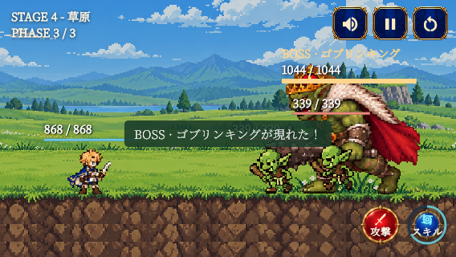
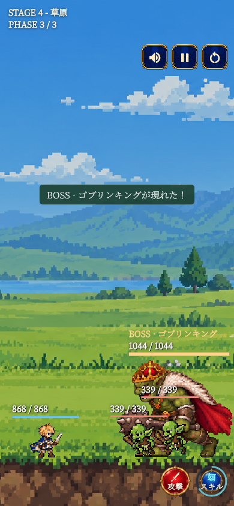

# マージ前の検証（2026年11月12日）

## 今回追加する変更

- 冒険のステージ・フェーズ表示を簡潔にし、攻撃・スキル操作を小型化。キャラクターを拡大し、遠距離エフェクトは従来の表示倍率を維持。
- 冒険からの撤退を一時停止画面に配置。集中・パーティー戦闘の描画をステージ内へクリップ。
- Androidビルド時のFlutter SDK自動検出と、USB接続端末への更新インストール・起動スクリプトを追加。
- 内容が空の `scripts/package-windows-app.ps1` は未完成のローカルファイルとして除外。

## 検証

- `flutter pub get`: 成功。
- `flutter analyze --no-pub`: 指摘なし。
- `flutter test --no-pub --reporter expanded --dart-define=CAPTURE_STAGE=true test/adventure_battle_hud_test.dart test/battle_replay_page_test.dart test/playable_stage_page_test.dart`: 19件成功。
- PowerShellの構文解析: `build-android.ps1`・`run-android.ps1` ともエラーなし。
- `git diff --check`: 成功。
- 小型横画面・縦長画面・タブレット・文字拡大の既存テストを実行。生成画像の568×320・390×844を目視確認。
- Android実機へのインストール・新規ビルドは今回未実施。
- 全体テストは今回再実行していない。[2026年10月30日の記録](VALIDATION_2026-10-30.md)には529件成功・37件失敗・1件スキップがあり、今回の対象テスト成功は全体の問題解消を意味しない。

## 画面例

